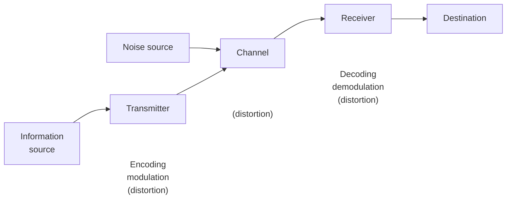

*Fig. 1.1 Block diagram of a communication system.*

This physical manifestation of the information is termed as messege signal

# Q1:  Explain the need for modulation
## A1 :The Need for Modulation in Communication Systems:

- **==🔴Long-distance transmission==:** Low-frequency message signals cannot travel far on their own; modulation shifts them to higher frequencies suitable for long-distance travel.

- ==🔴**Practicable Antenna Size==:** Antenna length must be comparable to a quarter-wavelength of the frequency used. Modulation increases the frequency, which decreases the wavelength and reduces the antenna size to a practical length.

- ==🔴**Preventing Signal Mixing==:** Since most message signals share the same frequency range, transmitting them directly would cause them to mix up. Modulation separates them by assigning each to a different carrier frequency.

- ==🔴**Spectrum Efficiency==:** Shifting signals to a high-frequency range makes them occupy a negligible percentage of the spectrum, allowing more signals to be accommodated simultaneously.

- **==🔴Conveying Information==:** An unmodulated carrier has constant parameters and cannot carry information. Modulation varies the carrier's parameters (like amplitude or frequency) according to the message signal to transmit data.
